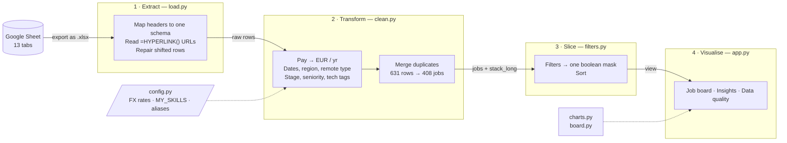
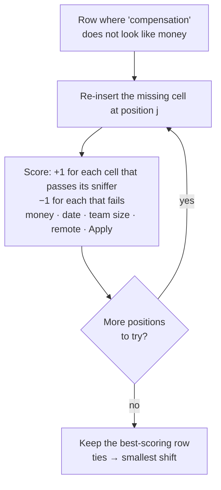
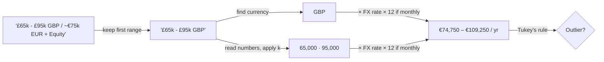
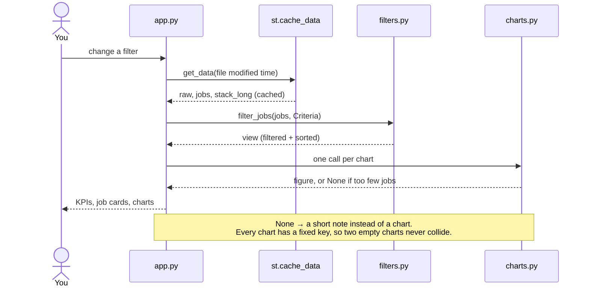
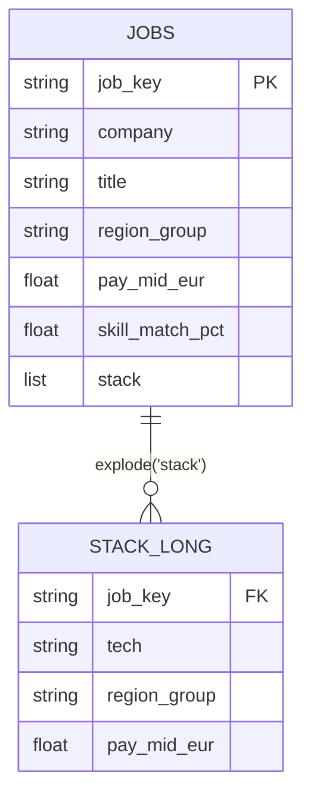

# Job hunt dashboard

A Streamlit dashboard built from the job-postings Google Sheet (13 tabs) using
pandas, NumPy and Plotly. For the step-by-step lessons, see [LEARN.md](LEARN.md).

## Run

```bash
uv sync
uv run streamlit run app.py      # opens http://localhost:8501
uv run pytest                    # 50 tests: parsers, filters, charts, full-app sweep
```

The app downloads the sheet on first run (it must be shared as "anyone with the
link"). The **Refresh from Google Sheet** button downloads it again.

## How it works

### The pipeline

Data moves one way, through four stages. Each stage is one module, so you can
run and test each stage separately.



### Fixing a shifted row

In 32 rows one cell was missing, so every value after it slid one column left.
`repair_shifted_rows` tries putting the gap back at each position, from the
compensation column leftwards. It scores each attempt with type sniffers and
keeps the best one.



### Turning one messy pay cell into numbers



### What happens when you change a filter

Streamlit re-runs `app.py` from top to bottom on every interaction. The slow
part (download, parse, clean) is cached, so a re-run only filters and draws.



Clicking **Refresh from Google Sheet** downloads the file again. Its modified
time changes, which is the cache key, so the next run rebuilds everything.

### Tidy data: one row per (job, technology)

`clean.build` returns two tables. `jobs` has one row per job. `stack_long` is
the same data "exploded" to one row per technology, so counting technologies
takes one line.



## Layout

| File | Role |
|---|---|
| `src/jobdash/load.py` | Extract: download, map headers to one schema, read link URLs, repair shifted rows |
| `src/jobdash/clean.py` | Transform: pay → EUR, dates, region, remote type, company stage, seniority, tech tags, de-duplication |
| `src/jobdash/config.py` | **Edit this:** FX rates, `MY_SKILLS`, tech-name aliases |
| `src/jobdash/filters.py` | Slice: filter choices → one boolean mask, plus sorting |
| `src/jobdash/board.py` | Text for each job card (Markdown-safe) |
| `src/jobdash/charts.py` | One Plotly function per chart; returns None when data is too thin |
| `app.py` | Streamlit layout: filters, KPIs, Job board / Insights / Data quality tabs |
